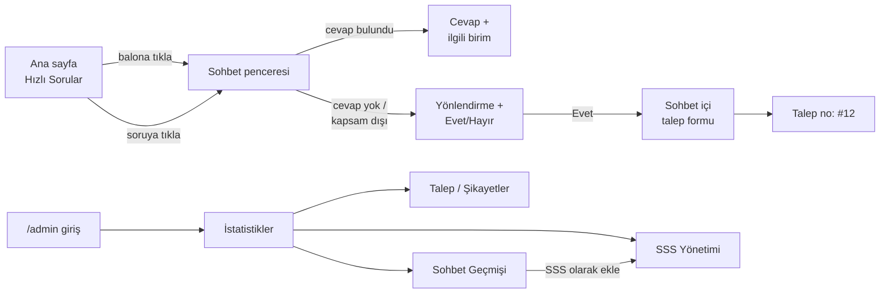

> **Bu proje bir staj çalışmasıdır. İçerdiği tüm veriler kurgusal demo verisidir, kurumun resmi verisi değildir.**

# Belediye Chatbot

**Belediye Vatandaş Hizmetleri Chatbotu:** Bir belediyenin Bilgi İşlem Dairesi Başkanlığı'ndaki zorunlu yaz stajı kapsamında geliştirilmiş, **tamamen yerelde (offline) çalışan** bir web chatbotu.

Vatandaşların belediyeye en sık sorduğu soruları (su faturası, imar, nikah, çöp toplama, zabıta, vergi, ulaşım…) otomatik yanıtlar. Cevap bulamadığında vatandaşı doğru birime yönlendirir ve sohbetin içinden **talep/şikayet kaydı** oluşturur. Amaç, çağrı merkezi ve Beyaz Masa'ya gelen tekrarlayan soru yükünü azaltmaktır.

- Vatandaşın sorusu, belediyenin **sık sorulan sorularıyla (SSS)** karşılaştırılır. Yöntem: **TF-IDF + cosine similarity**.
- Benzerlik skoru **0.35 ve üzerindeyse** cevap ve sorumlu birim gösterilir.
- Skor düşükse veya konu belediyenin görev alanı dışındaysa (elektrik, doğalgaz…) vatandaş yönlendirilir ve **“Talep olarak kaydedeyim mi?”** diye sorulur.
- **Admin paneli:** SSS yönetimi, talep takibi ve grafiklerle kullanım istatistikleri.
- Ücretli API, internet bağlantısı veya harici servis **gerekmez**.

---

## İçindekiler

1. [Hızlı başlangıç (çift tıkla)](#1-hızlı-başlangıç)
2. [Kurulum ve çalıştırma yöntemleri](#2-kurulum-ve-çalıştırma-yöntemleri)
3. [Yardımcı dosyalar](#3-yardımcı-dosyalar-bat)
4. [Ekran akışı](#4-ekran-akışı)
5. [Özellikler](#5-özellikler)
6. [Kullanılan teknolojiler](#6-kullanılan-teknolojiler)
7. [Chatbot nasıl çalışır?](#7-chatbot-nasıl-çalışır)
8. [Doğruluk ölçümü](#8-doğruluk-ölçümü)
9. [Testler](#9-testler)
10. [Proje yapısı](#10-proje-yapısı)
11. [Güvenlik önlemleri](#11-güvenlik-önlemleri)
12. [Sınırlılıklar](#12-sınırlılıklar)
13. [Dokümanlar](#13-dokümanlar)

---

## 1. Hızlı başlangıç

> Gereksinim: Bilgisayarda **Python 3.11 veya üzeri** kurulu olmalı.
>
> Kaynak kodu: **https://github.com/HekimSefkan/belediye-chatbot**
> İndirmek için `git clone https://github.com/HekimSefkan/belediye-chatbot.git` komutunu çalıştırın ya da GitHub sayfasındaki **Code → Download ZIP** seçeneğini kullanın.

1. Proje klasöründeki **`basla.bat`** dosyasına **çift tıklayın**.
2. Birkaç saniye içinde tarayıcı **http://127.0.0.1:5000** adresinde açılır.
3. Admin paneli: **http://127.0.0.1:5000/admin**. Kullanıcı adı `admin`, şifre `admin123`.
4. Uygulamayı kapatmak için siyah pencereyi kapatın ya da **Ctrl+C** tuşlarına basın.

`basla.bat` sanal ortamı (`venv`) **etkinleştirmez**. venv içindeki Python'u tam yoluyla çalıştırır. Bu yüzden:

- PowerShell'in *“running scripts is disabled on this system”* hatası oluşmaz.
- *“Python was not found; run without arguments to install from the Microsoft Store”* hatası oluşmaz.
- Proje GitHub'dan yeni indirildiyse ve `venv` klasörü yoksa, ilk açılışta venv'i **otomatik oluşturur** ve paketleri yükler. İlk açılış birkaç dakika sürebilir ve internet gerektirir.

---

## 2. Kurulum ve çalıştırma yöntemleri

### Yöntem 1 – `basla.bat` (önerilen)

Dosya Gezgini'nde `basla.bat` dosyasına çift tıklamanız yeterlidir. PowerShell'den çalıştırmak isterseniz:

```powershell
.\basla.bat
```

### Yöntem 2 – venv içindeki Python'u tam yoluyla çalıştırma

Aktivasyon yapmadan, proje klasöründe açılmış PowerShell'de:

```powershell
# (Sadece ilk kurulumda) sanal ortamı oluştur ve paketleri yükle
py -3 -m venv venv
.\venv\Scripts\python.exe -m pip install -r requirements.txt

# Uygulamayı başlat
.\venv\Scripts\python.exe app.py
```

> `py` komutu bulunamazsa, Python'un kurulu olduğu tam yolu kullanın. Örnek: `& "$env:LOCALAPPDATA\Programs\Python\Python312\python.exe" -m venv venv`

### Yöntem 3 – Sanal ortamı etkinleştirerek (klasik yöntem)

PowerShell, güvenlik nedeniyle betik (`Activate.ps1`) çalıştırmayı varsayılan olarak engeller. Bu engeli **sadece kendi kullanıcı hesabınız için** bir kez kaldırabilirsiniz:

```powershell
Set-ExecutionPolicy -Scope CurrentUser -ExecutionPolicy RemoteSigned
```

- **Yönetici (Administrator) yetkisi gerektirmez.** Ayar sadece sizin Windows kullanıcınızı etkiler.
- `RemoteSigned` politikası, bilgisayarınızda oluşturulan betiklerin çalışmasına izin verir. İnternetten indirilen betikler ise dijital imzalı olmadıkça yine engellenir. Güvenli ve yaygın bir ayardır.
- Geri almak için: `Set-ExecutionPolicy -Scope CurrentUser -ExecutionPolicy Undefined`

Ardından:

```powershell
venv\Scripts\activate
python app.py
```

### Linux / macOS

```bash
python3 -m venv venv
venv/bin/python -m pip install -r requirements.txt
venv/bin/python app.py
```

### Ayarlar (`.env`, isteğe bağlı)

Uygulama `.env` dosyası **olmadan da** varsayılan ayarlarla çalışır. Ayarları değiştirmek için `.env.example` dosyasını `.env` adıyla kopyalayıp düzenleyin.

| Değişken | Varsayılan | Açıklama |
|---|---|---|
| `SECRET_KEY` | *(boş)* | Oturum çerezlerini imzalar. Boş bırakılırsa rastgele üretilip `instance/secret_key` dosyasına kaydedilir (önerilen; bu dosya GitHub'a yüklenmez). |
| `ADMIN_USERNAME` | `admin` | Admin kullanıcı adı. Değiştirilirse eski kullanıcı adıyla kalan admin hesabı silinir. |
| `ADMIN_PASSWORD` | `admin123` | Admin şifresi. Her açılışta hash'lenip veritabanına yazılır. Varsayılan şifre kullanılıyorsa panelde uyarı çıkar. |
| `SIMILARITY_THRESHOLD` | `0.35` | Cevabın “bulundu” sayılması için gereken en düşük benzerlik skoru |
| `FLASK_DEBUG` | `False` | Sadece geliştirirken `True` yapın. Açıkken hata sayfaları kaynak kodu gösterir. |
| `PORT` | `5000` | Sunucu portu |

---

## 3. Yardımcı dosyalar (`.bat`)

| Dosya | Ne yapar? | Ne zaman kullanılır? |
|---|---|---|
| **`basla.bat`** | Uygulamayı başlatır, tarayıcıyı açar, gerekirse ilk kurulumu yapar | Her kullanımda |
| **`sifirla.bat`** | Veritabanını silip 70 demo SSS ile yeniden oluşturur. Onay için `E` yazmanız istenir. | **Demodan önce** temiz başlangıç için (önce `basla.bat` penceresini kapatın) |
| **`testleri_calistir.bat`** | 108 otomatik testi çalıştırır ve sonucu gösterir | Kodda değişiklik yaptıktan sonra |

---

## 4. Ekran akışı



**Vatandaş tarafı**

1. **Ana sayfa:** Belediye tanıtım alanı, kategori kartlarında **Hızlı Sorular** ve “Nasıl çalışır?” bölümü. Sağ altta yuvarlak sohbet balonu bulunur.
2. **Sohbet penceresi:** Karşılama mesajı ve 10 kategori butonu gösterilir. Soru yazılır ya da bir butona tıklanır.
3. **Cevap bulunduğunda:** Cevap metni ve altında *“Temizlik İşleri · İlgili birim: Temizlik İşleri Dairesi Başkanlığı”* bilgisi görünür.
4. **Cevap bulunamadığında:** *“Net bir cevap bulamadım”* mesajı, yönlendirilen birim, varsa benzer soru önerileri ve **Evet, talep oluştur / Hayır** butonları gösterilir.
5. **Konu kapsam dışıysa** (örn. *“elektrik faturamı nasıl öderim”*): *“Bu konu belediyemizin hizmet alanı dışında görünüyor”* mesajı ve talep seçeneği gösterilir.
6. **Talep formu:** Sohbetin içinde açılır, konu ve birim önceden doludur. Gönderilince vatandaşa talep numarası verilir.

Telefonda sohbet penceresi tam ekran açılır.

**Yönetici tarafı** (`/admin`)

1. **Giriş:** kullanıcı adı ve şifre.
2. **İstatistikler:** toplam soru, cevaplanamayan oranı, talep sayıları, 3 grafik (en çok sorulan kategoriler, cevaplanan/cevaplanamayan, son 7 gün) ve **son cevaplanamayan sorular** tablosu.
3. **SSS Yönetimi:** listeleme, kategori filtresi, arama, ekleme, düzenleme ve silme. Değişiklikler chatbota **anında** yansır.
4. **Talep / Şikayetler:** duruma göre filtreleme. Durum kutusundan *Beklemede → İşlemde → Tamamlandı* seçilip **Kaydet** butonuna basılır.
5. **Sohbet Geçmişi:** tüm mesajlar ve skorları. Cevaplanamayan bir soru **“SSS olarak ekle”** bağlantısıyla tek tıkla bilgi tabanına eklenir.

Adım adım demo senaryosu: [docs/test_senaryolari.md](docs/test_senaryolari.md)

---

## 5. Özellikler

- Türkçe karakter kullanmadan yazılan soruları anlama (`cop toplama gunleri` → Temizlik İşleri)
- Farklı eklerle yazılan kelimeleri eşleştirme (`faturamı / faturası / faturayı`)
- Selamlama ve teşekkür mesajlarına kısa cevap
- Kapsam dışı konuları (elektrik, doğalgaz, sağlık, eğitim…) tanıyıp yanlış cevap vermeme
- Sohbet içinde alan bazlı hata mesajları gösteren talep formu
- Tüm sohbetlerin kaydedilmesi ve istatistiklerde kullanılması
- Mobil uyumlu arayüz (vatandaş ve admin)
- Tamamen offline çalışma: Chart.js dahil tüm dosyalar projenin içinde

## 6. Kullanılan teknolojiler

| Katman | Teknoloji | Neden seçildi? |
|---|---|---|
| Backend | **Python 3.11+, Flask** | Öğrenmesi kolay, hafif, stajyer ölçeğinde bir proje için yeterli |
| Veritabanı | **SQLite** | Kurulum gerektirmez, tek dosya, belediye sunucusunda ek servis istemez |
| Doğal dil eşleştirme | **scikit-learn** (TF-IDF + cosine similarity) | Ücretsiz, offline, hızlı. Her sonucun *neden* verildiği skorla açıklanabilir. |
| Frontend | **HTML, düz CSS, vanilla JavaScript** | Ek kütüphane yok, kod baştan sona okunabilir |
| Grafikler | **Chart.js 4.4.1** (yerel dosya) | Kurumsal ağda internet olmasa da çalışır |
| Güvenlik | **Werkzeug** (şifre hash'leme) | Flask ile birlikte gelir |
| Test | **pytest** | Python'un standart test aracı |
| Sürüm kontrolü | **Git** | Anlamlı commit geçmişi |

---

## 7. Chatbot nasıl çalışır?

```
"Su faturamı nasıl ödeyebilirim?"
        │ 1) Ön işleme: küçük harf → Türkçe karakter → noktalama → stopword → ilk 5 harf
        ▼
"su fatur odeye"
        │ 2) TF-IDF vektörüne dönüştürme
        ▼
        │ 3) 70 SSS vektörüyle cosine similarity
        ▼
En yüksek skor: 0.66  →  "Su faturamı nasıl ödeyebilirim?"
        │ 4) Kapsam dışı kelime var mı? (elektrik, doğalgaz…)  → hayır
        │ 5) Skor ≥ 0.35 ?  → evet
        ▼
Cevap + "Su ve Kanalizasyon Dairesi Başkanlığı"
```

| Adım | Açıklama |
|---|---|
| **Küçük harf** | Türkçeye uygun: `İ → i`, `I → ı` (Python'un `lower()` fonksiyonu bunu yanlış yapar) |
| **Karakter normalizasyonu** | `ç ğ ı ö ş ü → c g i o s u`. Türkçe klavyesi olmayan kullanıcı da anlaşılır. |
| **Stopword** | Konu belirtmeyen kelimeler atılır: *ve, mi, nasıl, nerede, istiyorum, durum, gün, zaman…* |
| **Kök bulma (F5)** | Kelimenin ilk 5 harfi alınır: *faturamı → fatur*. Ek kütüphane gerektirmez. |
| **TF-IDF** | Bir soruda sık, diğerlerinde seyrek geçen kelimeye yüksek ağırlık verir (*“iskan”* ayırt edicidir, *“belediye”* değildir) |
| **Cosine similarity** | İki vektör arasındaki açının kosinüsüdür. 1 = aynı kelimeler, 0 = ortak kelime yok. |
| **Eşik 0.35** | Bu değerin üstü “cevap bulundu” sayılır. 0.30–0.35 arasında en yakın SSS'nin birimine, daha düşük skorda Beyaz Masa'ya yönlendirilir. |
| **Kapsam dışı kontrolü** | Mesajda *elektrik, doğalgaz, hastane, okul…* gibi bir kelime varsa ve bu kelime eşleşen SSS'de geçmiyorsa eşleşme reddedilir |

Model uygulama açılırken bir kez eğitilir ve bellekte tutulur. Admin bir SSS'yi ekleyince, düzenleyince veya silince yeniden eğitilir.

Ayrıntılı diyagramlar: [docs/mimari_diyagram.md](docs/mimari_diyagram.md)

## 8. Doğruluk ölçümü

`scripts/dogruluk_olcumu.py` betiği, seed verisindeki sorulardan **farklı ifade edilmiş** sorularla ölçüm yapar:

```powershell
.\venv\Scripts\python.exe scripts\dogruluk_olcumu.py
```

| Soru seti | İyileştirme öncesi | İyileştirme sonrası |
|---|---|---|
| İlgili sorular (40) – doğru kategori | 40/40 | 40/40 |
| Alakasız sorular (15) – reddetme | 12/15 | **15/15** |
| **Kontrol seti** (20) – ayarlamada **hiç kullanılmadı** | 13/20 (%65) | **15/20 (%75)** |

Kontrol seti, yöntemin daha önce görmediği sorulardaki gerçekçi başarısını gösterir. Tüm tablolar: [docs/dogruluk_olcumu.md](docs/dogruluk_olcumu.md)

## 9. Testler

`testleri_calistir.bat` dosyasına çift tıklayın ya da:

```powershell
.\venv\Scripts\python.exe -m pytest -v
```

**108 test** bulunur:

| Dosya | Test | Kapsam |
|---|---|---|
| `tests/test_matcher.py` | 34 | Metin ön işleme, eşleştirme doğruluğu, kapsam dışı kontrolü, cevap türleri |
| `tests/test_api.py` | 21 | `/api/chat` ve `/api/talep`, admin girişi, CSRF, SQL injection denemesi |
| `tests/test_admin_akisi.py` | 1 | **Admin panelinin uçtan uca kullanımı:** giriş → cevaplanamayan sorudan SSS oluşturma → düzenleme → silme → talep durumu → çıkış |
| `tests/test_guvenlik_ve_hatalar.py` | 52 | Sahte oturum çerezi, debug modu, giriş denemesi sınırı, güvenlik başlıkları, bozuk JSON gövdeleri, telefon/alan doğrulaması, emoji ve İngilizce mesajlar, admin sayfalarında XSS, bozuk seed/veritabanı hataları |

Testler geçici bir veritabanı kullanır, gerçek `chatbot.db` dosyasına dokunmaz.

---

## 10. Proje yapısı

```
belediye-chatbot/
├── basla.bat               # ÇİFT TIKLA: uygulamayı başlatır
├── sifirla.bat             # Demo öncesi veritabanını sıfırlar
├── testleri_calistir.bat   # Testleri çalıştırır
├── app.py                  # Flask giriş noktası (application factory)
├── config.py               # Ayarlar (.env'den okunur, yoksa varsayılanlar)
├── requirements.txt
├── .env.example
├── instance/               # (otomatik oluşur, GitHub'a yüklenmez) bu bilgisayara özel oturum anahtarı
├── database/
│   ├── schema.sql          # Tablo tanımları
│   ├── seed_data.json      # 10 kategori, 70 kurgusal demo SSS
│   └── db.py               # Bağlantı, kurulum ve ortak sorgular
├── chatbot/
│   ├── preprocessor.py     # Türkçe metin temizleme, stopword ve kapsam dışı kelime listeleri
│   ├── matcher.py          # TF-IDF + cosine similarity eşleştirme
│   └── responses.py        # Eşleşme sonucunu vatandaş cevabına dönüştürme
├── routes/
│   ├── chat_routes.py      # Ana sayfa
│   ├── api_routes.py       # /api/chat, /api/talep, /api/hizli-sorular, /api/departmanlar
│   └── admin_routes.py     # Admin paneli
├── templates/              # Jinja2 HTML şablonları (index.html + admin/)
├── static/
│   ├── css/                # style.css (vatandaş), admin.css (panel)
│   └── js/                 # chat.js, admin_charts.js, chart.umd.min.js (yerel Chart.js)
├── scripts/
│   └── dogruluk_olcumu.py  # Doğruluk ölçümü
├── tests/                  # pytest testleri
└── docs/                   # Mimari, veritabanı, kılavuz, test, rapor, sunum, savunma belgeleri
```

## 11. Güvenlik önlemleri

- **SQL injection:** Tüm sorgular `?` yer tutucularıyla (parametreli) yazılmıştır. Bunu doğrulayan bir test de vardır.
- **Şifre saklama:** Admin şifresi `werkzeug.security` ile hash'lenir, düz metin olarak saklanmaz.
- **Oturum anahtarı:** `SECRET_KEY` kodda sabit değildir. Her kurulumda rastgele üretilir ve GitHub'a yüklenmeyen `instance/secret_key` dosyasında tutulur. Böylece sahte admin çerezi üretilemez.
- **Giriş güvenliği:**
  - 5 hatalı denemeden sonra giriş 5 dakika kilitlenir.
  - Girişte oturum yenilenir ve en fazla 8 saat açık kalır.
  - Silinen admin hesabının oturumu geçersiz olur.
  - Yönlendirmeler yalnızca site içi adreslere yapılır.
- **CSRF:** Admin panelindeki tüm POST formları oturuma özel bir token ile korunur. Çerezler `HttpOnly` ve `SameSite=Lax`.
- **XSS:** Sohbet mesajları ekrana `textContent` ile yazılır. Jinja2 çıktıları otomatik olarak kaçışlar (escape).
- **Tarayıcı başlıkları:** `X-Frame-Options: DENY` (başka sitede iframe içinde açılamaz), `X-Content-Type-Options: nosniff`, `Referrer-Policy`.
- **Girdi doğrulama:** Alan türü, uzunluk sınırları, telefon formatı (10–13 rakam), departman listesi kontrolü ve en fazla 64 KB istek boyutu.
- **Hata yönetimi:**
  - Debug modu varsayılan olarak kapalıdır.
  - Beklenmeyen hatalarda kullanıcıya iç ayrıntı gösterilmez.
  - API hataları Türkçe JSON mesajı döner.
- `.env`, `instance/` ve veritabanı dosyası `.gitignore` ile GitHub'a yüklenmez.

> Varsayılan şifre (`admin123`) sadece demo içindir; kullanıldığı sürece admin panelinde uyarı görünür. Gerçek kullanımda `.env` dosyasından değiştirilmelidir. Güvenlik analizinin ayrıntıları: [docs/proje_analizi.md](docs/proje_analizi.md)

## 12. Sınırlılıklar

**TF-IDF kelime benzerliğine bakar, anlama bakmaz.** Bu projenin en önemli sınırlılığıdır. Aynı kelimeleri içeren ama anlamı farklı sorular yanlış eşleşebilir. Kontrol setinde gözlenen gerçek örnekler:

| Vatandaşın sorusu | Chatbotun eşleştirdiği SSS | Neden? |
|---|---|---|
| telefon faturamı ödemek istiyorum | Su faturamı nasıl ödeyebilirim? | “fatura” ve “ödemek” ortak |
| vergi dairesi nerede | Emlak vergisi ne zaman ödenir? | “vergi” ortak. Vergi dairesi belediyeye değil devlete bağlıdır. |
| araba kiralamak istiyorum | Düğün salonu veya sosyal tesis kiralayabilir miyim? | “kiralamak” ortak |
| internet paketim bitti | Belediyenin ücretsiz Wi-Fi hizmeti nerelerde var? | “internet” anahtar kelimesi ortak |
| kimlik kartımı yenilemek istiyorum | Öğrenci kartı nasıl çıkarılır? | “kart” ortak |

İyileştirme öncesinde *“hava durumu nasıl olacak”* sorusu *“İmar durum belgesi”* ile, *“doğalgaz faturası çok yüksek geldi”* sorusu ise *“Su faturam çok yüksek geldi”* ile eşleşiyordu. Genişletilmiş stopword listesi ve kapsam dışı kelime kontrolüyle bunlar düzeltildi. Ancak bu listeler elle hazırlanır ve her durumu kapsayamaz.

Diğer sınırlılıklar:
- **Eş anlamlıları bilmez:** *“lağım”* ile *“kanalizasyon”* ancak SSS'nin anahtar kelimelerinde ikisi de yazılıysa eşleşir.
- **Yazım hatalarına toleransı sınırlıdır:** *“faturmı”* gibi harf hataları kök bulmayı bozabilir.
- **Bağlamı hatırlamaz:** Her mesaj bağımsız değerlendirilir. *“Peki ücreti ne kadar?”* gibi önceki soruya bağlı sorular anlaşılmaz.
- **Bilgi tabanı kadar iyidir:** SSS'de olmayan konuyu bilemez. Bu yüzden sohbet geçmişinden SSS oluşturma akışı eklenmiştir.
- Tek admin kullanıcısı vardır, rol yönetimi yoktur. Flask'ın geliştirme sunucusu kullanılır; gerçek yayında Waitress/Gunicorn gibi bir WSGI sunucusu ve HTTPS gerekir.
- Genel API'de (sohbet, talep) hız sınırı ve KVKK kapsamında veri saklama süresi tanımlı değildir. Açık kalan diğer maddeler için [docs/proje_analizi.md](docs/proje_analizi.md) “Grup 3” bölümüne bakın.

**Geliştirme fikirleri:** Levenshtein mesafesiyle yazım hatası toleransı, eş anlamlı sözlüğü, anlamsal benzerlik için yerel çalışan bir kelime vektörü modeli, sesli soru (Web Speech API), talep durumunu vatandaşın sorgulayabilmesi. İsteğe bağlı olarak bir LLM katmanı da eklenebilir; ancak bu *ücretli/harici servis gerektirdiği için kurumsal ortamda kullanılmayabilir.*

## 13. Dokümanlar

| Belge | İçerik |
|---|---|
| [docs/kullanici_kilavuzu.md](docs/kullanici_kilavuzu.md) | Vatandaş ve yönetici kullanım kılavuzu |
| [docs/mimari_diyagram.md](docs/mimari_diyagram.md) | Sistem mimarisi ve akış diyagramları |
| [docs/veritabani_semasi.md](docs/veritabani_semasi.md) | Tablolar ve ER diyagramı |
| [docs/test_senaryolari.md](docs/test_senaryolari.md) | Otomatik testler ve manuel demo senaryoları |
| [docs/dogruluk_olcumu.md](docs/dogruluk_olcumu.md) | İyileştirme öncesi/sonrası doğruluk tabloları |
| [docs/proje_analizi.md](docs/proje_analizi.md) | Güvenlik, kod kalitesi, test ve UX analizi: 39 bulgu, düzeltilenler ve açık kalanlar |
| [docs/staj_raporu_taslagi.md](docs/staj_raporu_taslagi.md) | Staj raporu için taslak metin |
| [docs/sunum_taslagi.md](docs/sunum_taslagi.md) | 10 slaytlık sunum içeriği ve konuşma notları |
| [docs/savunma_sorulari.md](docs/savunma_sorulari.md) | Komisyonun sorabileceği sorular ve cevapları |
