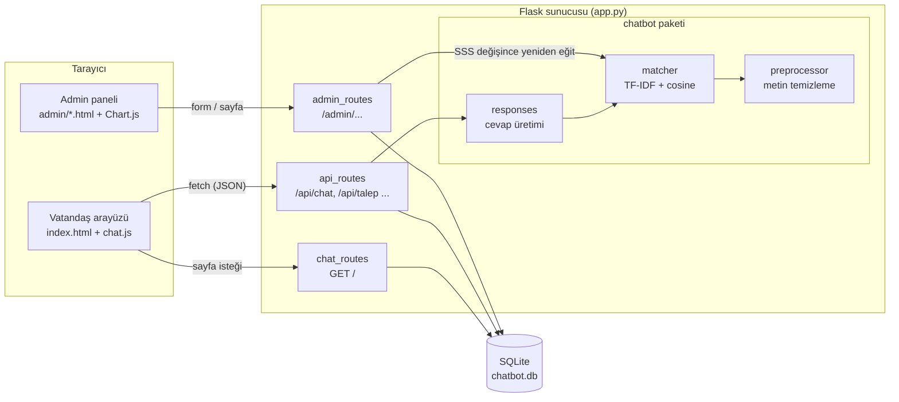
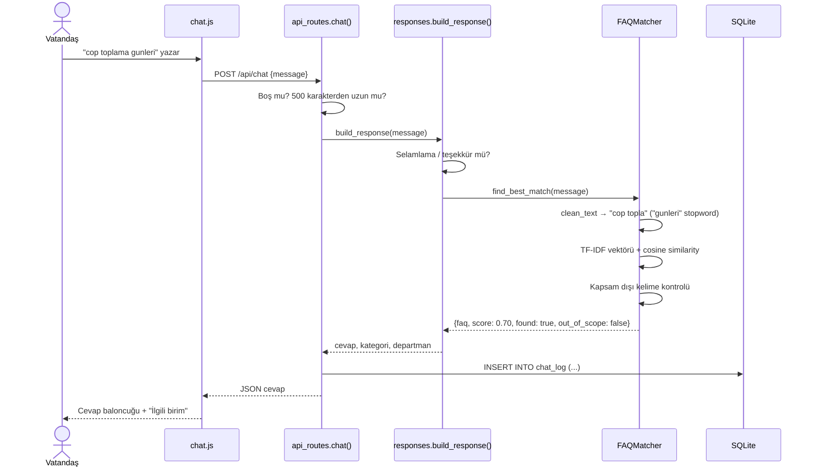
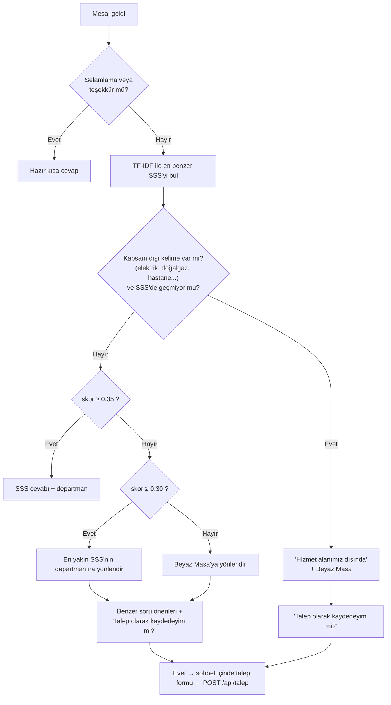

# Mimari Diyagram

> Bu proje bir staj çalışmasıdır. İçerdiği tüm veriler kurgusal demo verisidir, kurumun resmi verisi değildir.

Uygulama klasik **üç katmanlı** bir web uygulamasıdır: tarayıcıdaki arayüz, Flask sunucusu ve SQLite veritabanı. Doğal dil eşleştirmesi, sunucunun içinde çalışan bir Python modülüdür. Dışarıdaki hiçbir servise istek gönderilmez.

## 1. Genel yapı

## 2. Bir mesajın yolculuğu (`POST /api/chat`)

## 3. Karar mantığı

**Kapsam dışı kontrolü neden var?** TF-IDF kelime benzerliğine baktığı için *“doğalgaz faturası çok yüksek geldi”* sorusu, *“Su faturam çok yüksek geldi”* SSS'siyle 0.73 skor alır. Belediyenin görev alanı dışındaki konuları gösteren küçük bir kelime listesi (`chatbot/preprocessor.py` → `OUT_OF_SCOPE_WORDS`) bu tür yanlış cevapları engeller.

## 4. Katmanların görevleri

| Katman | Dosyalar | Görev |
|---|---|---|
| Sunum (arayüz) | `templates/`, `static/` | Sohbet penceresi, hızlı sorular, admin ekranları |
| Uygulama (Flask) | `app.py`, `routes/` | İstekleri karşılama, doğrulama, oturum, yönlendirme |
| İş mantığı | `chatbot/` | Metin ön işleme, eşleştirme, cevap üretimi |
| Veri | `database/` | Tablo şeması, demo veri, sorgu yardımcıları |

## 5. Tasarım kararları

- **Application factory (`create_app`)**: Testlerde geçici veritabanıyla ayrı bir uygulama örneği oluşturabilmek için kullanılır.
- **Blueprint'ler**: Vatandaş sayfası, API ve admin paneli ayrı dosyalarda tutulur. Böylece kod okunabilir kalır.
- **Model bellekte**: TF-IDF modeli her mesajda değil, uygulama açılırken bir kez eğitilir. SSS eklenince veya değişince yeniden eğitilir, bu yüzden cevaplar milisaniyeler içinde döner.
- **Ücretli API yok**: Belediye ağında internet kısıtlı olabileceği için tüm bileşenler (Chart.js dahil) yereldedir.
- **Sunucu: waitress**: `app.py` uygulamayı Flask'ın geliştirme sunucusu yerine saf Python bir üretim (WSGI) sunucusu olan waitress ile `127.0.0.1` üzerinde başlatır. Sadece `FLASK_DEBUG=True` iken geliştirme sunucusu kullanılır.
