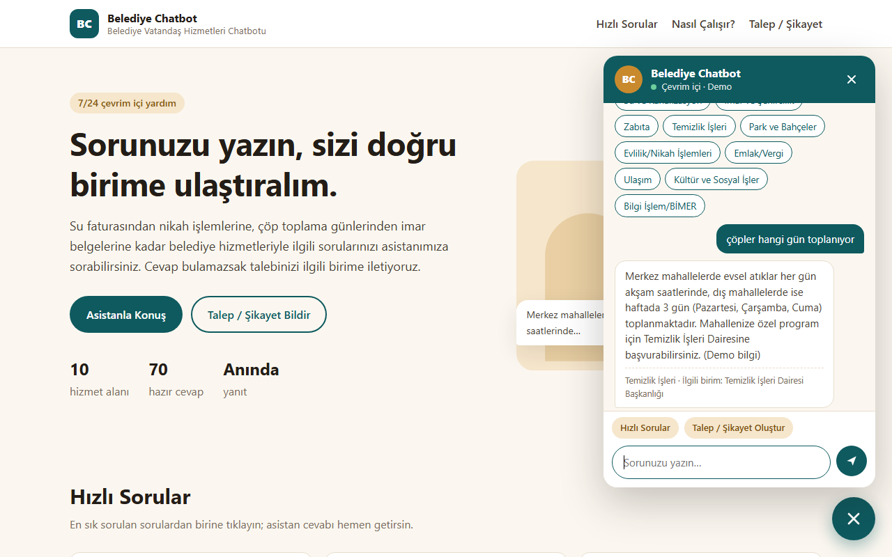
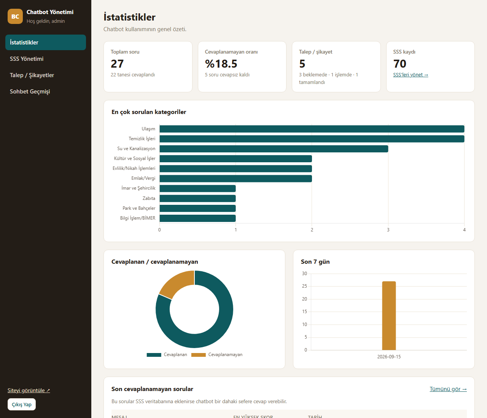

# Staj Raporu Taslağı – Belediye Chatbot

> Bu proje bir staj çalışmasıdır. İçerdiği tüm veriler kurgusal demo verisidir, kurumun resmi verisi değildir.

> **Nasıl kullanılır?** Bu metin staj raporuna aktarılmak üzere hazırlanmış bir taslaktır. `[köşeli parantez]` içindeki yerleri kendi bilgilerinle doldur. Cümleleri kendi anlatım tarzına göre düzenle. Şekil ve tablolar için `docs/` klasöründeki diyagramlardan ve uygulamanın ekran görüntülerinden yararlanabilirsin.

---

## 1. Giriş

### 1.1 Stajın yapıldığı kurum

Zorunlu yaz stajımı `[staj başlangıç – bitiş tarihleri]` tarihleri arasında, 20 iş günü boyunca `[kurum adı]` Bilgi İşlem Dairesi Başkanlığı'nda yaptım. Bilgi İşlem Dairesi; belediyenin yazılım altyapısının, e-belediye hizmetlerinin, ağ ve donanım sistemlerinin yönetiminden sorumludur. `[Birimin yapısı, çalışan sayısı, kullanılan sistemler hakkında gözlemlerini ekle.]`

### 1.2 Staj projesinin konusu

Staj süresince, vatandaşların belediyeye en sık sorduğu soruları otomatik yanıtlayan, cevap bulamadığında vatandaşı doğru birime yönlendiren ve talep/şikayet kaydı oluşturabilen web tabanlı bir chatbot olan **Belediye Chatbot**'u geliştirdim.

---

## 2. Problem Tanımı

Belediyeler, vatandaşlardan telefon, e-posta, Beyaz Masa ve CİMER gibi kanallar üzerinden çok sayıda soru alır. Bu soruların önemli bir kısmı tekrarlayan, cevabı standart olan sorulardır:

- *“Su faturamı nasıl ödeyebilirim?”*
- *“Mahallemde çöpler hangi günler toplanıyor?”*
- *“Nikah için hangi belgeler gerekiyor?”*
- *“Emlak vergisi ne zaman ödenir?”*

Bu soruların personel tarafından tek tek cevaplanması:
- Çağrı merkezi ve Beyaz Masa üzerinde iş yükü oluşturur.
- Mesai saatleri dışında vatandaşın bilgiye ulaşmasını zorlaştırır.
- Vatandaşın hangi birime başvurması gerektiğini bilmemesi nedeniyle yanlış birimlere yönlendirmelere yol açar.

**Projenin amacı:** Sık sorulan soruları 7/24 otomatik yanıtlayan, cevap veremediğinde vatandaşı ilgili birime yönlendiren ve talebini kayıt altına alan, **ücretli servislere bağımlı olmadan kurum içinde çalışabilen** bir chatbot geliştirmektir.

---

## 3. Yapılan Analiz

### 3.1 İhtiyaç analizi

Projenin kapsamını belirlerken şu soruları yanıtladım:

| Soru | Karar |
|---|---|
| Kimler kullanacak? | Vatandaşlar (soru sorma, talep oluşturma) ve belediye personeli (SSS ve talep yönetimi) |
| Hangi konular? | 10 hizmet alanı: Su ve Kanalizasyon, İmar ve Şehircilik, Zabıta, Temizlik İşleri, Park ve Bahçeler, Evlilik/Nikah, Emlak/Vergi, Ulaşım, Kültür ve Sosyal İşler, Bilgi İşlem/BİMER |
| Cevap bulunamazsa? | Vatandaş ilgili birime yönlendirilmeli ve talep oluşturabilmeli |
| Hangi ortamda çalışacak? | Kurumsal ağda internet erişimi kısıtlı olabilir. Sistem **offline** çalışmalı. |
| Maliyet? | Ücretli API veya lisans gerektirmemeli |
| Bakım? | Teknik bilgisi olmayan personel, SSS'leri bir panelden güncelleyebilmeli |

### 3.2 Fonksiyonel gereksinimler

1. Vatandaş, web sayfasındaki sohbet penceresinden doğal dilde soru sorabilmeli.
2. Sistem en uygun cevabı göstermeli; bulamazsa yönlendirme ve talep oluşturma seçeneği sunmalı.
3. Kategori bazlı “Hızlı Sorular” listesi olmalı.
4. Vatandaş, sohbet üzerinden talep/şikayet kaydı oluşturabilmeli.
5. Yönetici, giriş yaptıktan sonra SSS kayıtlarını ekleyip düzenleyip silebilmeli.
6. Yönetici, talepleri listeleyip durumlarını güncelleyebilmeli.
7. Yönetici panelinde kullanım istatistikleri olmalı.
8. Tüm sohbet geçmişi kaydedilmeli.

### 3.3 Fonksiyonel olmayan gereksinimler

- Türkçe karakter desteği ve Türkçe karakter kullanmadan yazılan soruları anlama
- Mobil uyumlu arayüz
- Temel güvenlik: SQL injection koruması, hash'lenmiş şifre
- Kolay kurulum: Tek dosyaya çift tıklayarak çalıştırma

### 3.4 Benzer çözümlerin incelenmesi

`[İncelediğin belediye chatbotlarını / e-devlet asistanlarını ve gözlemlerini buraya yaz.]`

Chatbot yaklaşımları genel olarak üç gruba ayrılır:

| Yaklaşım | Artı | Eksi |
|---|---|---|
| Kural tabanlı (anahtar kelime / karar ağacı) | Basit, öngörülebilir | Her ifade biçimi için ayrı kural gerekir |
| İstatistiksel benzerlik (TF-IDF vb.) | Az veriyle çalışır, açıklanabilir, hızlı | Anlamı değil kelimeleri karşılaştırır |
| Büyük dil modelleri (LLM) | Doğal dili çok iyi anlar | Ücretli, internet ister, veri gizliliği riski, bilgi uydurabilir |

Proje kısıtları (offline, ücretsiz, açıklanabilir, 20 günde tamamlanabilir) nedeniyle **istatistiksel benzerlik (TF-IDF)** yaklaşımını seçtim.

---

## 4. Kullanılan Teknolojiler ve Seçim Nedenleri

| Teknoloji | Kullanım amacı | Seçilme nedeni |
|---|---|---|
| **Python 3.12** | Ana programlama dili | Okunabilir sözdizimi, doğal dil işleme ve makine öğrenmesi kütüphanelerinin zenginliği |
| **Flask** | Web sunucusu ve yönlendirme | Hafif ve öğrenmesi kolay; Django gibi büyük çatıların getirdiği karmaşıklık bu ölçekte gereksiz |
| **SQLite** | Veritabanı | Ayrı bir veritabanı sunucusu kurmayı gerektirmez; tek dosya olduğu için taşınması ve yedeklenmesi kolay |
| **scikit-learn** | TF-IDF ve cosine similarity | Endüstride yaygın, güvenilir ve iyi belgelenmiş; ücretsiz ve offline |
| **HTML, CSS, JavaScript** | Kullanıcı arayüzü | Ek framework (React, Bootstrap) kullanılmadı; kodun tamamı anlaşılır ve bağımlılık yok |
| **Chart.js** | Admin panelindeki grafikler | Kolay kullanımlı. CDN yerine projeye dahil edildi, internet olmadan da çalışıyor. |
| **Werkzeug** | Şifre hash'leme | Flask ile birlikte gelir, ek bağımlılık gerektirmez |
| **pytest** | Otomatik testler | Python'un en yaygın test aracı, sade sözdizimi |
| **Git** | Sürüm kontrolü | Değişikliklerin adım adım kaydı ve GitHub üzerinden paylaşım |

---

## 5. Sistem Mimarisi

Sistem üç katmanlı bir web uygulamasıdır:

1. **Sunum katmanı:** Vatandaşın gördüğü ana sayfa ve sohbet penceresi, yöneticinin kullandığı admin paneli
2. **Uygulama katmanı:** İstekleri karşılayan Flask sunucusu ve chatbot modülü
3. **Veri katmanı:** SQLite veritabanı

`[Şekil 1: docs/mimari_diyagram.md içindeki “Genel yapı” diyagramını ekle]`

### 5.1 Chatbot modülünün çalışma adımları

Vatandaş bir mesaj gönderdiğinde:

1. **Ön işleme:** Mesaj Türkçeye uygun şekilde küçük harfe çevrilir (`İ → i`, `I → ı`). Türkçe karakterler sadeleştirilir (`ç → c`), noktalama işaretleri ve anlam taşımayan kelimeler (*ve, mi, nasıl, durum, gün…*) çıkarılır.
2. **Kök bulma:** Her kelimenin ilk 5 harfi alınır. Böylece *faturamı, faturası, faturayı* kelimelerinin hepsi *fatur* köküne indirgenir.
3. **TF-IDF vektörü:** Temizlenmiş mesaj, SSS'lerden öğrenilmiş kelime ağırlıklarıyla bir sayı vektörüne dönüştürülür.
4. **Cosine similarity:** Mesaj vektörü, 70 SSS vektörünün her biriyle karşılaştırılır ve en yüksek benzerlik skoru bulunur.
5. **Kapsam dışı kontrolü:** Mesajda *elektrik, doğalgaz, hastane* gibi belediyenin görev alanı dışındaki bir kelime varsa ve bu kelime eşleşen SSS'de geçmiyorsa eşleşme reddedilir.
6. **Karar:**
   - Skor ≥ 0.35: SSS cevabı ve sorumlu birim gösterilir.
   - 0.30 ≤ skor < 0.35: Cevap verilmez, en yakın SSS'nin birimine yönlendirilir.
   - Skor < 0.30: Genel birime (Beyaz Masa) yönlendirilir.
   - Cevap verilmeyen her durumda vatandaşa talep oluşturma seçeneği sunulur.
7. **Kayıt:** Mesaj, cevap, skor ve kategori sohbet geçmişine yazılır.

`[Şekil 2: docs/mimari_diyagram.md içindeki “Karar mantığı” diyagramını ekle]`

### 5.2 Önemli tasarım kararları

- **Model bellekte tutulur:** TF-IDF modeli her mesajda değil, uygulama açılırken bir kez eğitilir. Yönetici SSS eklediğinde veya değiştirdiğinde otomatik yeniden eğitilir.
- **Modüler yapı:** Vatandaş sayfası, API ve admin paneli ayrı dosyalarda (Flask blueprint) tutulur.
- **Application factory:** Uygulama bir fonksiyonla oluşturulur. Testlerde gerçek veritabanı yerine geçici veritabanı kullanılabilir.

---

## 6. Veritabanı Tasarımı

Veritabanında dört tablo bulunur:

| Tablo | Amaç | Önemli alanlar |
|---|---|---|
| `faq` | Chatbotun bilgi tabanı | kategori, soru, cevap, anahtar_kelimeler, departman |
| `talep_sikayet` | Vatandaş talepleri | ad_soyad, telefon, konu, aciklama, departman, durum |
| `chat_log` | Sohbet geçmişi | kullanici_mesaji, bot_cevabi, benzerlik_skoru, cevap_bulundu_mu, kategori |
| `admin` | Yönetici hesapları | kullanici_adi, sifre_hash |

Tasarımda dikkat edilen noktalar:
- Talep durumu `CHECK` kısıtıyla yalnızca *Beklemede, İşlemde, Tamamlandı* değerlerini alabilir.
- `chat_log` tablosuna, istatistik grafiği için eşleşen SSS'nin **kategorisi** metin olarak kaydedilir. Bir SSS silinse bile geçmiş istatistikler bozulmaz.
- Şifreler düz metin olarak değil, hash olarak saklanır.
- Başlangıç verisi olarak 10 kategoride 70 **kurgusal** soru-cevap hazırlandı. Bu veriler gerçek belediye bilgisi değildir.

`[Şekil 3: docs/veritabani_semasi.md içindeki ER diyagramını ekle]`

---

## 7. Karşılaşılan Teknik Zorluklar ve Çözümleri

### 7.1 Türkçenin eklemeli yapısı

**Sorun:** *“faturamı”* ve *“faturası”* bilgisayar için tamamen farklı kelimelerdir. TF-IDF bunları eşleştiremez.
**Çözüm:** Kelimelerin ilk 5 harfini kök olarak alan basit bir kök bulma yöntemi (F5) uyguladım. Zemberek gibi kapsamlı morfolojik analiz araçları Java tabanlı ve kurulumu karmaşık olduğundan tercih edilmedi.

### 7.2 Türkçe karakter ve büyük/küçük harf sorunu

**Sorun:** Python'un `lower()` fonksiyonu `I` harfini `i` yapar; Türkçede doğrusu `ı`dır. Ayrıca bazı vatandaşlar Türkçe karakter kullanmadan yazar (*“cop toplama gunleri”*).
**Çözüm:** Önce `I/İ` harflerini elle dönüştüren Türkçeye özel bir küçük harf fonksiyonu yazdım. Ardından tüm Türkçe karakterleri İngilizce karşılıklarına çevirdim. Böylece *“çöp”* ve *“cop”* aynı kabul edildi.

### 7.3 “su” kelimesinin iki anlamı

**Sorun:** Türkçe stopword listelerinde bulunan *“şu”* zamiri, karakter sadeleştirmeden sonra *“su”* hâline gelir. Belediye chatbotunda ise *su* (içme suyu) çok önemli bir kelimedir.
**Çözüm:** *“su”* kelimesini stopword listesinden özel olarak çıkardım.

### 7.4 Yanlış pozitif eşleşmeler

**Sorun:** *“hava durumu nasıl olacak”* sorusu “durum” kelimesi yüzünden *“İmar durum belgesi”* ile eşleşiyordu. *“doğalgaz faturası çok yüksek geldi”* sorusu ise *“Su faturam çok yüksek geldi”* sorusuyla 0.73 gibi yüksek bir skor alıyordu.
**Çözüm:**
- Önce sorunu ölçmek için bir doğruluk ölçüm betiği yazdım.
- Konu belirtmeyen genel kelimeleri (*durum, gün, zaman, olacak*) stopword listesine ekledim.
- Belediyenin görev alanı dışındaki konuları gösteren küçük bir kelime listesi (*elektrik, doğalgaz, hastane, okul…*) oluşturdum.
- Ayarlamada hiç kullanmadığım 20 soruluk bir kontrol setiyle başarının %65'ten %75'e çıktığını doğruladım.

### 7.5 Eşik değerinin belirlenmesi

**Sorun:** Eşik çok düşük olursa yanlış cevaplar, çok yüksek olursa doğru cevapların kaybı artar.
**Çözüm:** Farklı ifade edilmiş 40 soru üzerinde skorları inceledim. Doğru eşleşmelerin en düşük skoru 0.36, alakasız soruların çoğu 0.32'nin altındaydı. Eşiği 0.35 olarak belirledim ve ayar dosyasından değiştirilebilir yaptım.

### 7.6 Kurulum ve çalıştırma sorunları (Windows)

**Sorun:** PowerShell, sanal ortamı etkinleştiren betiği güvenlik politikası nedeniyle çalıştırmadı (*“running scripts is disabled”*). Python yeni kurulduğu için PATH güncellenmemişti ve `python` komutu Microsoft Store kısayoluna yönleniyordu.
**Çözüm:** Sanal ortamı etkinleştirmeden, venv içindeki Python'u tam yoluyla çalıştıran `basla.bat` dosyası hazırladım. Bu dosya çift tıklanarak çalışıyor ve sanal ortam yoksa kendisi kuruyor. Ayrıca demo öncesi veritabanını sıfırlayan `sifirla.bat` ve testleri çalıştıran `testleri_calistir.bat` dosyalarını ekledim.

### 7.7 Güvenlik

**Sorun:** Vatandaşın yazdığı metin doğrudan veritabanına ve ekrana yazılıyordu; SQL injection ve XSS riskleri vardı.
**Çözüm:** Tüm SQL sorgularını parametreli yazdım ve mesajları ekrana `textContent` ile bastım. Admin formlarına CSRF token ekledim ve bunları otomatik testlerle doğruladım.

### 7.8 Proje sonu analizinde bulunan kritik güvenlik açığı

**Sorun:** Proje tamamlandıktan sonra tüm kodu dosya dosya yeniden inceledim ve bulguları gerçek isteklerle denedim (`docs/proje_analizi.md`). En ciddi bulgu şuydu:
- Flask'ın admin oturumunu imzaladığı gizli anahtar (`SECRET_KEY`) kodda sabit bir değer olarak yazılıydı ve kod GitHub'da herkese açıktı.
- Bu anahtarla sahte bir oturum çerezi ürettim ve **şifre girmeden** admin paneline girebildiğimi gördüm.

Aynı analizde başka sorunlar da çıktı:
- Debug modu varsayılan olarak açıktı; hata sayfaları kaynak kodu gösteriyordu.
- `.env`'de admin kullanıcı adı değiştirilince eski demo hesabı açık kalıyordu.
- Liste türünde JSON gönderilince sunucu 500 hatası veriyordu.

**Çözüm:**
- Gizli anahtar artık her kurulumda rastgele üretiliyor ve GitHub'a yüklenmeyen bir dosyada saklanıyor.
- Debug modu varsayılan olarak kapatıldı.
- Eski admin hesapları otomatik siliniyor.
- Giriş denemesine sınır ve tarayıcı güvenlik başlıkları eklendi.
- Her bulgu için bir test yazdım; testler bulguların tekrar ortaya çıkmasını önlüyor. İlk analizde 39 bulgunun 26'sını düzelttim, staj kapsamını aşan 13'ünü raporladım (teslim öncesi turla birlikte toplam 43 bulgu, 30'u düzeltildi).

**Ders:** Güvenlik önlemlerini listelemek yeterli değil; saldırganın bakış açısıyla **denemek** gerekir.

### 7.9 Demo öncesi terminal çıktısındaki sorunlar

**Sorun:** Uygulamayı demo için çalıştırdığımda terminalde üç dikkat çekici satır gördüm:
- `GET /favicon.ico 404`
- `POST /api/talep 400`
- `WARNING: This is a development server`

**Çözüm:**
- **Favicon:** Harici dosya indirmeden, saf Python ile küçük bir sohbet balonu simgesi (`favicon.ico`) ürettim; artık 404 yerine 200 dönüyor.
- **400 cevabı:** Bu, bir alanın doğrulamadan geçmediğini gösteriyordu. Kuralları makul buldum ama kullanıcının nedeni fark etmesi zordu. Zorunlu alanları `*` ile işaretledim, reddedilen alanı kırmızıyla ve nedeniyle gösterdim, konsola da hangi alanın reddedildiğini (kişisel veriyi yazmadan) yazdırdım.
- **Uyarı:** Flask'ın geliştirme sunucusuna ait bu uyarıyı, uygulamayı tek paketlik üretim sunucusu **waitress** ile başlatarak kaldırdım.

Aynı aşamada talep formuna KVKK aydınlatma notu ekledim ve `.bat` dosyalarının Türkçe karakterli çıktı vermesini sağladım.

---

## 8. Test Süreci

Uygulamayı beş grupta test ettim:

| Test türü | Kapsam | Sayı |
|---|---|---|
| Birim testleri | Ön işleme, kök bulma, eşleştirme, kapsam dışı kontrolü | 34 |
| API testleri | Sohbet ve talep uç noktaları, doğrulama, güvenlik, admin girişi | 21 |
| Uçtan uca senaryo | Admin: giriş → SSS oluştur/düzenle/sil → talep durumu → çıkış | 1 |
| Güvenlik ve hata testleri | Sahte oturum çerezi, giriş sınırı, bozuk istekler, uç durum mesajları, bozuk veritabanı/seed dosyası | 52 |
| Teslim öncesi testler | Favicon, talep red mesajları ve konsol kaydı, aydınlatma notu, waitress sunucusu, `.bat` biçimi | 14 |
| **Toplam** | | **122 (hepsi başarılı)** |

Ayrıca tarayıcıda masaüstü ve mobil görünümde 20 manuel senaryo uyguladım (`docs/test_senaryolari.md`). Bunlara sohbete `<script>` içeren mesaj gönderilerek yapılan XSS denemesi de dahildir.

---

## 9. Sonuç

Staj süresince, belediyelerin tekrarlayan vatandaş sorularına yönelik gerçek bir problemi çözen, uçtan uca çalışan bir web uygulaması geliştirdim. Proje sonunda:

- Vatandaşların 10 hizmet alanındaki sorularını yanıtlayan bir chatbot,
- Cevap bulunamadığında yönlendirme ve talep kaydı,
- SSS, talep ve istatistik yönetimi sağlayan bir admin paneli,
- 122 otomatik test, doğruluk ölçüm betiği ve güvenlik analizi raporu,
- Kurulum, kullanım ve teknik dokümantasyon

hazırlandı. Uygulama internet bağlantısı veya ücretli servis gerektirmeden çalışmaktadır.

**Kazanımlarım:** `[Kendi cümlelerinle yaz. Örnek başlıklar:]`
- Bir yazılım projesini ihtiyaç analizinden teslime kadar yürütme deneyimi
- Flask ile web uygulaması geliştirme ve REST API tasarımı
- Doğal dil işlemenin temel kavramları (TF-IDF, cosine similarity, stopword, stemming)
- Web güvenliğinin temel konuları (SQL injection, XSS, CSRF, şifre hash'leme)
- Otomatik test yazma ve ölçüme dayalı iyileştirme yapma
- Git ile sürüm kontrolü
- Kamu kurumunda Bilgi İşlem biriminin çalışma düzenini gözlemleme

---

## 10. Geliştirmeye Açık Yönler

| Sınırlılık | Önerilen geliştirme |
|---|---|
| Yöntem anlamı değil kelimeleri karşılaştırıyor (*“telefon faturası”* → *su faturası*) | Yerel çalışan bir kelime vektörü (word embedding) modeliyle anlamsal benzerlik |
| Eş anlamlıları bilmiyor (*lağım / kanalizasyon*) | Belediye terimleri için eş anlamlı kelime sözlüğü |
| Yazım hatalarına toleransı sınırlı | Levenshtein mesafesiyle en yakın kelimeyi bulma |
| Önceki mesajı hatırlamıyor | Basit bir konuşma bağlamı (son konu) tutma |
| Bilgi tabanı kurgusal | Gerçek belediye SSS'leriyle bilgi tabanının oluşturulması |
| Vatandaş talebinin durumunu göremiyor | Talep numarasıyla durum sorgulama |
| Tek yönetici hesabı | Birim bazlı yetkilendirme (her birim kendi taleplerini görsün) |
| Sadece yerel ağda çalışan waitress sunucusu | HTTPS sağlayan IIS/nginx ile yayın, belediye web sitesine entegrasyon |
| KVKK: aydınlatma notu var ama saklama süresi yok | Kurum hukuk birimiyle saklama süresi ve eski kayıtları silme süreci |

---

## Ekler

- **Ek-1:** Kaynak kodu – https://github.com/HekimSefkan/belediye-chatbot
- **Ek-2:** Ekran görüntüleri – `docs/ekran_goruntuleri/` (kurgusal demo verisiyle alınmıştır)

| Şekil | Dosya | İçerik |
|---|---|---|
| Ek-2.1 | `01_ana_sayfa.png` | Ana sayfa, sohbet kapalı |
| Ek-2.2 | `02_sohbet_cevap.png` | Sohbette başarılı cevap ve ilgili birim |
| Ek-2.3 | `03_cevap_bulunamadi.png` | Cevap bulunamayan soru, birim yönlendirmesi, talep butonları |
| Ek-2.4 | `04_talep_formu.png` | Doldurulmuş talep formu ve aydınlatma notu |
| Ek-2.5 | `05_talep_basari.png` | Talep numaralı başarı mesajı |
| Ek-2.6 | `06_talep_hata_mesaji.png` | Hatalı alanların işaretlenmesi |
| Ek-2.7 | `07_mobil_sohbet.png` | 390 px mobil görünüm |
| Ek-2.8 | `08_admin_sss_listesi.png` | Admin – SSS yönetimi |
| Ek-2.9 | `09_admin_talepler.png` | Admin – talep/şikayet listesi |
| Ek-2.10 | `10_admin_istatistik.png` | Admin – istatistik grafikleri |

- **Ek-3:** Doğruluk ölçüm tabloları – `docs/dogruluk_olcumu.md`
- **Ek-4:** Test senaryoları – `docs/test_senaryolari.md`

## Kaynaklar

`[Rapor formatına uygun şekilde düzenle]`
- Flask Documentation – https://flask.palletsprojects.com
- scikit-learn: TfidfVectorizer ve cosine_similarity belgeleri – https://scikit-learn.org
- SQLite Documentation – https://www.sqlite.org/docs.html
- Chart.js Documentation – https://www.chartjs.org/docs
- OWASP Top 10 (web güvenliği riskleri) – https://owasp.org/www-project-top-ten/
- Can, F. vd. (2008). *Information retrieval on Turkish texts.* Journal of the American Society for Information Science and Technology. (Türkçede ilk-n-harf kök bulma yöntemi)
