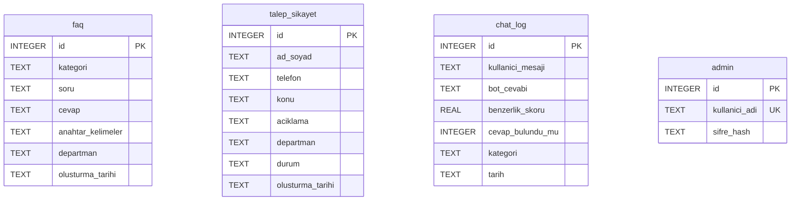

# Veritabanı Şeması

> Bu proje bir staj çalışmasıdır. İçerdiği tüm veriler kurgusal demo verisidir, kurumun resmi verisi değildir.

Veritabanı olarak **SQLite** kullanılır. Kurulum gerektirmez ve tüm veriler tek bir dosyada (`database/chatbot.db`) tutulur. Tablolar `database/schema.sql` dosyasında tanımlıdır ve uygulama ilk açıldığında otomatik oluşturulur.

## ER diyagramı



Tablolar arasında yabancı anahtar (foreign key) ilişkisi **bilerek kurulmamıştır**:

- `chat_log.kategori` metin olarak saklanır. Bir SSS silinse bile geçmiş istatistikler bozulmaz.
- `talep_sikayet.departman` da metindir. Departman listesi SSS'lerden ve genel yönlendirme biriminden (Beyaz Masa) oluşturulur.

## Tablolar

### `faq` – Sık sorulan sorular

Chatbotun bilgi tabanıdır. TF-IDF modeli bu tablodaki `soru` ve `anahtar_kelimeler` alanlarıyla eğitilir.

| Alan | Tip | Açıklama |
|---|---|---|
| `id` | INTEGER, PK | Otomatik artan numara |
| `kategori` | TEXT, zorunlu | Örn. “Su ve Kanalizasyon” |
| `soru` | TEXT, zorunlu | Vatandaşın soracağı şekilde yazılmış örnek soru |
| `cevap` | TEXT, zorunlu | Botun göstereceği cevap |
| `anahtar_kelimeler` | TEXT | Eşleşmeyi güçlendiren eş anlamlılar (boşlukla ayrılmış) |
| `departman` | TEXT, zorunlu | Sorudan sorumlu birim |
| `olusturma_tarihi` | TEXT | Varsayılan: kaydın eklendiği an |

### `talep_sikayet` – Talep ve şikayetler

| Alan | Tip | Açıklama |
|---|---|---|
| `id` | INTEGER, PK | Vatandaşa verilen talep numarası |
| `ad_soyad` | TEXT, zorunlu | En fazla 100 karakter |
| `telefon` | TEXT | İsteğe bağlı. Rakam, boşluk, `+ - ( )` karakterleri kabul edilir. |
| `konu` | TEXT, zorunlu | En fazla 150 karakter |
| `aciklama` | TEXT, zorunlu | En fazla 2000 karakter |
| `departman` | TEXT, zorunlu | Listedeki birimlerden biri olmalıdır |
| `durum` | TEXT | `Beklemede` (varsayılan), `İşlemde`, `Tamamlandı`. `CHECK` kısıtıyla bunların dışındaki değerler reddedilir. |
| `olusturma_tarihi` | TEXT | Kayıt anı |

### `chat_log` – Sohbet geçmişi

Her mesaj kaydedilir. Bu kayıtlar istatistik sayfasında ve SSS veritabanını geliştirmede (cevaplanamayan soruları bulmakta) kullanılır.

| Alan | Tip | Açıklama |
|---|---|---|
| `id` | INTEGER, PK | |
| `kullanici_mesaji` | TEXT | Vatandaşın yazdığı metin (olduğu gibi) |
| `bot_cevabi` | TEXT | Botun verdiği cevap |
| `benzerlik_skoru` | REAL | En iyi eşleşmenin cosine similarity değeri (0–1) |
| `cevap_bulundu_mu` | INTEGER | 1: bulundu, 0: bulunamadı |
| `kategori` | TEXT | Eşleşen SSS'nin kategorisi (bulunamadıysa NULL) |
| `tarih` | TEXT | Mesaj zamanı |

> **Not:** Proje önerisindeki şemaya ek olarak `kategori` sütunu eklenmiştir. İstatistik sayfasındaki “en çok sorulan kategoriler” grafiği bu sütunla hesaplanır.

### `admin` – Yönetici kullanıcılar

| Alan | Tip | Açıklama |
|---|---|---|
| `id` | INTEGER, PK | |
| `kullanici_adi` | TEXT, benzersiz | Varsayılan: `admin` |
| `sifre_hash` | TEXT | `werkzeug.security.generate_password_hash` çıktısı. Şifre asla düz metin olarak saklanmaz. |

Uygulama her açılışta `.env` dosyasındaki `ADMIN_USERNAME` / `ADMIN_PASSWORD` değerlerini bu tabloyla eşitler. Şifre değiştiyse hash yenilenir.

## Örnek sorgular

```sql
-- Cevaplanamayan soru oranı (%)
SELECT ROUND(100.0 * SUM(cevap_bulundu_mu = 0) / COUNT(*), 1) FROM chat_log;

-- En çok sorulan kategoriler
SELECT kategori, COUNT(*) AS adet
FROM chat_log WHERE kategori IS NOT NULL
GROUP BY kategori ORDER BY adet DESC;

-- Bekleyen talepler (en yeniden eskiye)
SELECT id, ad_soyad, konu, departman FROM talep_sikayet
WHERE durum = 'Beklemede' ORDER BY id DESC;
```

## Demo veri seti

`database/seed_data.json` dosyasında **10 kategori × 7 soru = 70 kurgusal SSS** bulunur. Veri, `faq` tablosu boşsa uygulama ilk açıldığında otomatik yüklenir. Telefon numaraları, ücretler, süreler ve prosedürler uydurmadır. Cevapların sonundaki “(Demo bilgi)” ibaresi de bunu belirtir.

| Kategori | Departman (demo) |
|---|---|
| Su ve Kanalizasyon | Su ve Kanalizasyon Dairesi Başkanlığı |
| İmar ve Şehircilik | İmar ve Şehircilik Dairesi Başkanlığı |
| Zabıta | Zabıta Dairesi Başkanlığı |
| Temizlik İşleri | Temizlik İşleri Dairesi Başkanlığı |
| Park ve Bahçeler | Park ve Bahçeler Dairesi Başkanlığı |
| Evlilik/Nikah İşlemleri | Evlendirme Memurluğu |
| Emlak/Vergi | Mali Hizmetler Dairesi Başkanlığı |
| Ulaşım | Ulaşım Dairesi Başkanlığı |
| Kültür ve Sosyal İşler | Kültür ve Sosyal İşler Dairesi Başkanlığı |
| Bilgi İşlem/BİMER | Bilgi İşlem Dairesi Başkanlığı |
